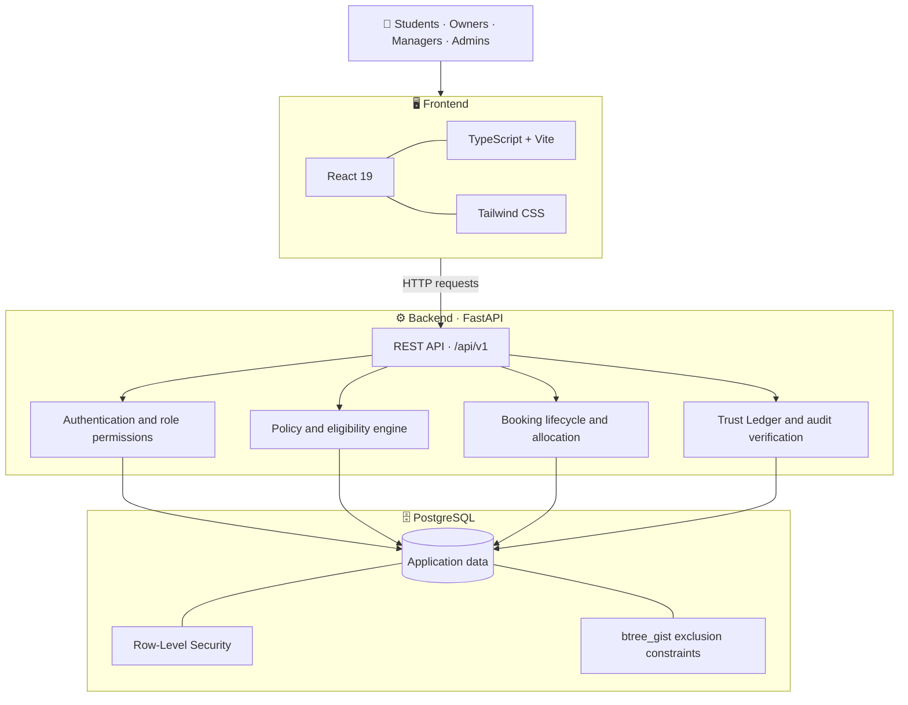

# 🌐 SHARESPACE

<div align="center">

### **Access more. Waste less. Build together.**

**A smarter way to share institutional resources — with accountability built into every step.**

[](https://react.dev/)
[](https://www.typescriptlang.org/)
[](https://fastapi.tiangolo.com/)
[](https://www.postgresql.org/)
[](https://www.python.org/)

*One platform. Shared resources. Clear rules. A traceable history.*

</div>

---

## 💡 What is SHARESPACE?

Think about a college laboratory with expensive equipment, multiple students who need access, safety requirements to check, and a lab manager who needs to keep track of everything.

Now imagine managing the entire process without scattered spreadsheets, confusing messages, or uncertainty about who used what.

**That's what SHARESPACE is built for.**

SHARESPACE is a multi-tenant resource-sharing and accountability platform for college laboratories, research facilities, makerspaces, and other institutional spaces. It brings resource discovery, eligibility checks, booking requests, staff approvals, equipment handovers, return inspections, incident reporting, and audit history into one connected workflow.

The goal isn't just to make booking easier. It's to make shared resources **easier to access, safer to manage, and more accountable to everyone involved.**

## 🎯 The problem we're solving

<div align="center">

| 😓 Without a connected workflow | ✅ With SHARESPACE |
|---|---|
| Scattered booking requests | Centralised resource discovery and booking |
| Unclear eligibility requirements | Explainable eligibility checks |
| Conflicting reservations | Database-backed overlap prevention |
| Informal approvals without context | Authorised decisions with recorded reasons |
| Unclear equipment condition at handover | Structured condition and return records |
| Incidents without a consistent review trail | Documented, human-reviewed resolution |
| Limited visibility into past actions | A verifiable, hash-chained audit ledger |

</div>

A shared resource should not become an administrative headache. SHARESPACE connects the process from the first booking request to the final return.

---

## ✨ What can you do with it?

<table>
<tr>
<td width="50%" valign="top">

### 🔎 Discover & Check Eligibility

Browse resources, review specifications, and understand access requirements before booking.

The eligibility engine checks eight areas, including institutional membership, verified training, operational status, scheduling conflicts, and usage limits.

</td>
<td width="50%" valign="top">

### 📅 Book & Allocate Fairly

Submit booking requests, receive authorised decisions, and track waitlist positions.

Idempotent booking requests and database-level exclusion constraints help prevent duplicate operations and overlapping confirmed reservations.

</td>
</tr>
<tr>
<td width="50%" valign="top">

### 🧰 Manage Handover & Returns

Record asset condition, required accessories, rule acknowledgements, and return inspections.

Supervised resources can require staff confirmation before the booking is closed.

</td>
<td width="50%" valign="top">

### 🛡️ Keep a Trust Ledger

Important actions are recorded in a chronological, SHA-256 hash-chained audit ledger.

The ledger can be verified to detect inconsistencies or tampering with recorded events.

</td>
</tr>
<tr>
<td width="50%" valign="top">

### 🧑‍⚖️ Review Incidents Responsibly

Report incidents with supporting details and evidence, discuss findings, and document a resolution.

An allegation is not automatically treated as proof of fault.

</td>
<td width="50%" valign="top">

### 📊 Understand Resource Usage

Review resource-utilisation information, access operational analytics, and export reports as CSV files.

Institutional administrators can manage roles, policies, and oversight.

</td>
</tr>
</table>

---

## 🔄 How SHARESPACE works

A booking is only one part of the process. Here's how the complete lifecycle fits together.

```mermaid
flowchart TD
    A["🔎 Discover resource"] --> B["✅ Check eligibility"]
    B --> C["📅 Submit booking request"]
    C --> D{"Available and eligible?"}

    D -- "No suitable slot" --> E["🕒 Waitlist or explain result"]
    D -- "Requires review" --> F["👤 Staff reviews request"]

    F --> G{"Decision"}
    G -- "Rejected" --> H["📝 Record reason"]
    G -- "Approved" --> I["🧰 Check-in and condition record"]

    I --> J["⚙️ Resource in use"]
    J --> K["🔍 Return inspection"]
    K --> L{"Incident reported?"}

    L -- "Yes" --> M["🧑‍⚖️ Human review and resolution"]
    L -- "No" --> N["✅ Complete return"]
    M --> N

    N --> O["🔐 Traceable audit history"]
    H --> O
    E --> O

    classDef start fill:#e0f2fe,stroke:#0284c7,color:#0c4a6e
    classDef decision fill:#fef3c7,stroke:#d97706,color:#78350f
    classDef end fill:#dcfce7,stroke:#16a34a,color:#14532d

    class A,I,J start
    class D,G,L decision
    class N,O end
```

### The important part

The backend decides whether an action is permitted. Eligibility, tenant boundaries, booking transitions, and staff permissions are not left to frontend checks alone.

That distinction matters when multiple users are competing for the same resource or when an action needs an auditable explanation.

---

## 🏗️ Under the hood

SHARESPACE uses a frontend, a REST API, and PostgreSQL as the system of record.



### 🧱 Technology stack

| Layer | Technologies |
|---|---|
| Frontend | React 19, TypeScript, Vite |
| Styling | Tailwind CSS |
| Backend API | Python, FastAPI, Uvicorn |
| Database | PostgreSQL |
| ORM & migrations | SQLAlchemy, Alembic |
| Async database driver | `asyncpg` |
| Security | Role-based permissions, PostgreSQL RLS, CORS, security headers, rate limiting |
| Audit integrity | SHA-256 hash chaining |
| Testing | Pytest, pytest-asyncio, Ruff, TypeScript checks |
| Packaging | Docker, Docker Compose |
| Optional AI | Google Gemini with deterministic fallback logic |

---

## 🔐 Engineering decisions that matter

SHARESPACE is designed around a few rules that should remain true as the project grows.

<details>
<summary><strong>🏢 1. Multi-tenant isolation</strong></summary>

Different institutions must not be able to access one another's records simply by changing an identifier in a request.

PostgreSQL Row-Level Security (RLS) provides a database-level layer of tenant isolation. The application also applies backend permission checks and transaction-scoped tenant context.

</details>

<details>
<summary><strong>📏 2. Rules are enforced by the backend</strong></summary>

The frontend helps users understand what they can do, but it is not the source of truth for access permissions, eligibility, or booking transitions.

The server evaluates the relevant rules and validates state changes.

</details>

<details>
<summary><strong>⚡ 3. Concurrent bookings need database protection</strong></summary>

Application-level availability checks alone are not enough when two requests arrive close together.

Idempotency and PostgreSQL exclusion constraints provide additional protection against duplicate operations and overlapping confirmed bookings.

</details>

<details>
<summary><strong>🔗 4. A Trust Ledger that can be checked</strong></summary>

Ledger events are linked using SHA-256 hashes. Verification checks the recorded chain for inconsistencies and broken links.

The correct term is **tamper-evident**. Hash chaining helps detect changes; it does not mean that tampering is physically impossible or that the ledger is a blockchain.

</details>

<details>
<summary><strong>🧑‍⚖️ 5. Accountability without automated blame</strong></summary>

Incident reports remain allegations until reviewed by authorised people. The system records the review and resolution rather than automatically assigning financial or academic penalties.

</details>

<details>
<summary><strong>🧠 6. AI is optional, not a gatekeeper</strong></summary>

AI can assist with selected tasks such as interpreting natural-language queries or structuring incident drafts.

Core booking workflows have deterministic logic and fallback paths. AI does not make final access, safety, liability, or penalty decisions.

</details>

---

## 👥 Who is it for?

| Role | What they can do |
|---|---|
| 🎓 **Student / User** | Discover resources, check eligibility, request bookings, manage bookings, and report issues. |
| 🧰 **Resource Owner** | Manage resources within their authorised scope. |
| 👨‍🔧 **Lab Manager** | Review requests, manage supervised handovers and returns, and review incidents. |
| 🛡️ **Administrator** | Manage roles and policies and oversee audit history. |

Permissions are enforced by the backend and scoped to the relevant organisation.

---

## 🚀 Run SHARESPACE locally

Want to explore the project or work on it? Docker Compose is the easiest way to start the full development stack.

### Requirements

- Git
- Docker Engine
- Docker Compose v2

### 1. Clone the repository

```bash
git clone https://github.com/abhineet-26/Share-Space.git
cd Share-Space
```

### 2. Start the stack

```bash
docker compose up --build
```

### 3. Open the services

| Service | Local address |
|---|---|
| 🖥️ Frontend | [localhost:3000](http://localhost:3000) |
| 💚 Backend health check | [localhost:8000/healthz](http://localhost:8000/healthz) |
| 🩺 Backend readiness check | [localhost:8000/readyz](http://localhost:8000/readyz) |
| 📘 API documentation | [localhost:8000/docs](http://localhost:8000/docs) |

The development stack is configured separately from production. Use unique secrets and suitable database permissions for any publicly deployed environment.

To stop the local services:

```bash
docker compose down
```

> ⚠️ `docker compose down -v` also removes the local database volume and its data. Use it only when you intentionally want to reset the local database.

For configuration details and alternative deployment methods, see [`docs/DEPLOYMENT.md`](docs/DEPLOYMENT.md).

---

## 🧪 Testing & verification

The repository includes tests for the backend's domain rules and core flows, including:

- 🔒 Tenant isolation and authentication permissions
- 📅 Booking lifecycle, concurrency, and waitlist handling
- 🧰 Condition reports and incident resolution
- 🔗 Trust Ledger integrity verification
- 📊 Notifications and analytics
- 🛡️ Security headers and rate limiting

### Run backend tests

```bash
cd backend
python3 -m venv .venv
source .venv/bin/activate
pip install -e ".[dev]"
pytest tests/ -v
```

### Run lint checks

```bash
ruff check .
```

### Build the frontend

Run from the repository root:

```bash
npm install
npm run build
```

Integration tests may require a configured test database. Use a disposable development or test database rather than production data.

📖 For the guided product walkthrough, see [`docs/TESTING.md`](docs/TESTING.md).

---

## ☁️ Deployment

SHARESPACE has a separate frontend and backend, so each component can be deployed independently or run together with Docker Compose.

A managed deployment needs:

- 🗄️ PostgreSQL with the required extension, permissions, and applied migrations.
- ⚙️ A backend service with production configuration and securely managed secrets.
- 🖥️ A frontend build configured to use the live API.
- 🌐 Correct CORS origins for the deployed frontend.
- 🩺 Health and readiness checks, plus an appropriate backup and operational plan.

A successful `/readyz` response confirms that the database is reachable. It does **not**, by itself, prove that every migration has been applied or that every product feature works end to end.

For the full deployment guide, see [`docs/DEPLOYMENT.md`](docs/DEPLOYMENT.md).

---

## 📍 Project status

**Current milestone: v0.1.0 MVP**

The implementation covers the core resource-sharing lifecycle and supporting accountability controls. Environment-specific deployment and end-to-end verification remain part of getting the complete application running reliably.

The next goal is to ensure the deployed experience works as consistently as the intended workflow — from discovering a resource and requesting a booking to returning the asset and checking the resulting audit history.

For implementation details and the functional requirements audit, see [`docs/IMPLEMENTATION_STATUS.md`](docs/IMPLEMENTATION_STATUS.md).

---

## 🗺️ What's next?

SHARESPACE is intended to grow beyond a single campus. Potential future work includes:

- 📱 Better asset identification and evidence workflows
- 🔑 Institutional sign-in through OIDC
- 📆 Calendar integrations and maintenance windows
- 🔔 More notification delivery options
- 🔌 APIs and webhooks for institutional systems
- 🏫 Easier onboarding for multiple organisations

These are roadmap directions, not promises that every feature is already available.

---

<div align="center">

### 🤝 Built around a simple idea

**Shared resources work better when access is clear and responsibility is traceable.**

Thanks for checking out SHARESPACE.

*Access more. Waste less. Build together.*

</div>
