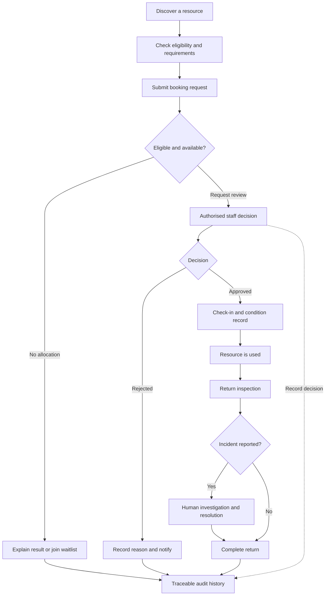
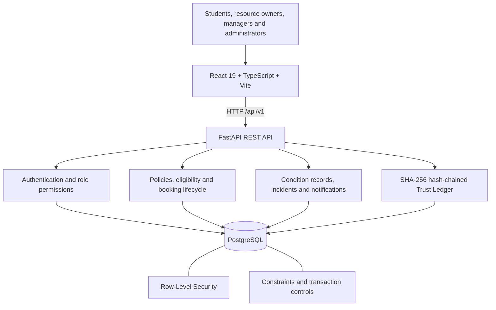

# SHARESPACE

### Access more. Waste less. Build together.

**A resource-sharing platform built around accountability, fair access, and responsible use of institutional assets.**

[](https://www.python.org/)
[](https://fastapi.tiangolo.com/)
[](https://react.dev/)
[](https://www.typescriptlang.org/)
[](https://www.postgresql.org/)

SHARESPACE is a multi-tenant platform for managing shared equipment, laboratories, research facilities, and other institutional resources. It brings the entire process into one place: discovering a resource, checking eligibility, requesting a booking, getting an authorised decision, recording handover and return conditions, and maintaining a traceable history of what happened.

The idea is straightforward: **sharing a resource should be easy to manage, but access and responsibility should never be left ambiguous.**

The project is being developed as a professional product, with its initial implementation focused on campus laboratories, makerspaces, and technical facilities.

---

## Contents

- [The problem](#the-problem)
- [What SHARESPACE does](#what-sharespace-does)
- [How the workflow works](#how-the-workflow-works)
- [What makes it different](#what-makes-it-different)
- [Architecture](#architecture)
- [Technology stack](#technology-stack)
- [Run locally](#run-locally)
- [Configuration](#configuration)
- [Testing](#testing)
- [Deployment](#deployment)
- [Project status](#project-status)

## The problem

Institutions often have equipment and spaces that are expensive to purchase, maintain, or replace, yet difficult to share efficiently.

A laboratory instrument might sit unused while another student needs it. A resource may have overlapping requests, specific safety-training requirements, or a supervised handover process. When these workflows are handled through spreadsheets, messages, and informal approvals, it becomes difficult to answer basic questions:

- Who is eligible to use this resource?
- Why was a request approved, rejected, or waitlisted?
- Was the equipment in good condition before and after use?
- Who reviewed an incident, and what was the outcome?
- Can one department access another department's records?
- Can the history of an important decision be checked later?

SHARESPACE addresses these problems by connecting resource discovery, policy-based eligibility, booking, operational records, and accountability in a single workflow.

## What SHARESPACE does

### Resource discovery and eligibility

Browse institutional resources, inspect specifications and availability, and understand the requirements attached to each resource.

The eligibility engine evaluates eight checks covering account verification, institutional membership, operational status, verified training, requested time window, scheduling conflicts, session-duration limits, and rolling usage limits. It returns reasons and next steps rather than treating every failed request as an unexplained rejection.

### Booking and fair allocation

Manage requests through an explicit booking lifecycle, with authorised staff decisions, required decision reasons, and waitlist handling.

Booking creation supports idempotency, while PostgreSQL exclusion constraints help prevent overlapping confirmed bookings for the same resource. Allocation rules can account for published priority factors, usage limits, and request time.

### Handover, returns, and condition records

Record the state of an asset at handover and return, including relevant checklists, acknowledgement of usage rules, and condition evidence.

Supervised resources can require staff confirmation before a booking is closed. Physical asset records and QR tokens support identification and contextual lookup; scanning a QR code does not grant access by itself.

### Incident reporting and human review

Record incidents against a booking or resource, attach relevant evidence, and keep the discussion and resolution history together.

An incident report is treated as an allegation until reviewed by authorised staff. **SHARESPACE does not automatically assign financial penalties or academic grade deductions.** Decisions that affect responsibility remain subject to human review.

### Trust Ledger and audit verification

Important actions are written to a chronological audit ledger linked through SHA-256 hashes. The chain can be checked to detect inconsistencies or tampering with recorded events.

The ledger is described as **tamper-evident**, not as an immutable blockchain. Its purpose is to make changes to the recorded history detectable and to give authorised users a way to verify that history.

### Institutional administration

The platform also includes:

- Versioned policies and policy activation with recorded reasons.
- Role-based access for users, resource owners, managers, and administrators.
- Organisation-scoped data isolation using PostgreSQL Row-Level Security (RLS).
- In-app notifications and an event outbox for handling side effects.
- Resource-utilisation analytics and CSV export.
- An optional assistive AI integration with deterministic fallbacks.

## How the workflow works

The main workflow follows a resource from discovery to closure.



The backend is responsible for validating permissions, eligibility, state transitions, and data access. The frontend presents the workflow, but it is not the authority for deciding whether an action is allowed.

## What makes it different

SHARESPACE is not intended to be just a calendar with a booking button.

| Design decision | Why it matters |
|---|---|
| Policy-driven eligibility | Users receive a clear explanation of requirements and failed checks. |
| Database-backed conflict prevention | Concurrent requests cannot simply bypass scheduling rules because they arrive at the same time. |
| Multi-tenant isolation | Organisation boundaries are enforced through PostgreSQL RLS, rather than relying only on frontend filters. |
| Recorded governance reasons | Important staff decisions and policy changes have an explanation attached. |
| Condition and incident history | Handover, return, and incident records provide context beyond the booking status. |
| Human-reviewed incidents | Reports do not automatically become findings of fault or penalties. |
| Hash-chained Trust Ledger | Recorded event history can be verified for tampering or inconsistencies. |
| Assistive, optional AI | AI can help structure input, but it does not make final access, safety, liability, or penalty decisions. |

These choices are intended to make resource sharing easier to administer without removing the controls institutions need to operate safely.

## Architecture

SHARESPACE uses a modular application architecture with a React frontend, a FastAPI service, and PostgreSQL as the system of record.



### Backend

The backend exposes the REST API and enforces application rules. It uses FastAPI, SQLAlchemy, and Alembic, with asynchronous PostgreSQL access through `asyncpg`.

### Database

PostgreSQL stores organisations, users, resources, policies, bookings, condition reports, incidents, notifications, and audit events.

Row-Level Security is used to enforce organisation boundaries. The `btree_gist` extension supports database-level exclusion constraints for overlapping bookings.

### Frontend

The frontend is built with React, TypeScript, Vite, and Tailwind CSS. The API integration supports both a local mock mode and a live backend mode, configured through environment variables.

### Assistive AI

AI integration is optional. Deterministic parsing and fallback logic support core workflows when an AI provider is unavailable. Final access decisions, safety checks, incident findings, and penalties remain outside the AI's authority.

## Technology stack

| Area | Technologies |
|---|---|
| Frontend | React 19, TypeScript, Vite, Tailwind CSS |
| Backend | Python 3.11+, FastAPI, Uvicorn |
| Database | PostgreSQL, SQLAlchemy, Alembic |
| Database controls | Row-Level Security, `btree_gist`, transaction-level tenant context |
| Authentication and access | Session/JWT-based authentication, role-based permissions |
| Audit history | SHA-256 hash chaining and ledger verification |
| Testing and quality | Pytest, pytest-asyncio, Ruff, TypeScript checks |
| Packaging and deployment | Docker, Docker Compose, managed application hosting |
| Optional AI | Google Gemini integration with deterministic fallback logic |

## Run locally

Docker Compose is the recommended starting point because it brings up the frontend, backend, and database together.

### Prerequisites

- Git
- Docker Engine
- Docker Compose v2

### 1. Clone the repository

```bash
git clone https://github.com/abhineet-26/Share-Space.git
cd Share-Space
```

### 2. Start the application

```bash
docker compose up --build
```

The local development stack exposes the following services:

| Service | URL |
|---|---|
| Frontend | http://localhost:3000 |
| Backend health check | http://localhost:8000/healthz |
| Backend readiness check | http://localhost:8000/readyz |
| Interactive API documentation | http://localhost:8000/docs |

The API is mounted under `/api/v1`.

> **Local development only:** Docker Compose uses development configuration and credentials intended for a local environment. Do not reuse them for a public deployment. Do not run demo seed/reset operations against a database containing real institutional data.

To stop the services:

```bash
docker compose down
```

To remove the local database volume as well, use `docker compose down -v`. This permanently deletes the local database data, so use it only when that is intended.

## Configuration

Configuration depends on whether the application is running locally or against a deployed backend.

### Frontend

The frontend reads these environment variables:

| Variable | Purpose |
|---|---|
| `VITE_API_MODE` | Set to `live` to use the backend API; mock mode is the default otherwise. |
| `VITE_API_BASE_URL` | Base URL of the backend, without the `/api/v1` suffix. |
| `VITE_ENABLE_AI` | Controls the frontend AI feature flag where supported. |

For local development against the Docker backend, the live API base URL is `http://localhost:8000`.

For a deployed frontend, set the base URL to the backend service origin, for example `https://your-backend.onrender.com`. The frontend appends `/api/v1` to API requests.

### Backend

Important backend configuration includes:

| Variable | Purpose |
|---|---|
| `DATABASE_URL` | Async database URL used by the application. |
| `DATABASE_MIGRATION_URL` | Async database URL used by migration operations. |
| `SYNC_DATABASE_URL` | Sync PostgreSQL URL used by Alembic configuration. |
| `SECRET_KEY` | Secret used for authentication-related signing. |
| `ENVIRONMENT` | Runtime environment, such as `development` or `production`. |
| `DEBUG` | Controls development behavior, including interactive API documentation. |
| `CORS_ORIGINS` | Comma-separated list of permitted frontend origins. |
| `ENABLE_DEMO_LOGIN` | Enables the demo login flow when explicitly configured. |

Use strong, unique secrets in deployed environments. Keep database credentials and API keys out of Git, frontend variables, logs, and public documentation.

For complete deployment configuration, see [`docs/DEPLOYMENT.md`](docs/DEPLOYMENT.md).

## Testing

The repository includes backend integration tests for core booking flows, access permissions, tenant isolation, ledger integrity, notifications, and related features.

From the repository root, install the backend with development dependencies:

```bash
cd backend
python3 -m venv .venv
source .venv/bin/activate
pip install -e ".[dev]"
```

Run backend tests:

```bash
pytest tests/ -v
```

Run lint checks:

```bash
ruff check .
```

From the repository root, install frontend dependencies and build the application:

```bash
npm install
npm run build
```

Integration tests may require a correctly configured test database. Use a disposable local or test database, never the production database. Check the test output and current CI results rather than assuming a previous pass guarantees that the current commit still passes.

For a guided end-to-end product walkthrough, see [`docs/TESTING.md`](docs/TESTING.md).

## Deployment

The application has separate frontend and backend components, so they can be deployed independently or together with Docker Compose.

For a managed deployment, configure:

1. A PostgreSQL database with the required extension and permissions.
2. A backend web service with database URLs, a strong secret key, production settings, and the correct CORS origins.
3. A static frontend build with live API mode and the backend base URL.
4. Database migrations as a deliberate deployment step before testing the application.
5. A safe strategy for demo data, backups, logs, and ongoing operational checks.

The backend provides `/healthz` for a health check and `/readyz` for a readiness check that also tests database connectivity. A successful readiness response confirms connectivity; it does not by itself confirm that every database migration has been applied.

See [`docs/DEPLOYMENT.md`](docs/DEPLOYMENT.md) for the deployment guide and [`docs/IMPLEMENTATION_STATUS.md`](docs/IMPLEMENTATION_STATUS.md) for the implementation audit.

## Project status

SHARESPACE is at the **v0.1.0 MVP stage**. The implementation covers the core resource-sharing lifecycle and its supporting accountability controls. Deployment configuration and environment-specific verification remain important parts of getting the full application running reliably.

The current priority is to keep the core workflow consistent from end to end: a resource can be discovered, a request can be evaluated and decided, handover and return can be recorded, incidents can be reviewed, and the relevant history can be checked.

The platform is designed to grow beyond a single campus into a system that multiple institutions can operate with clearly separated data and configurable policies.

---

**SHARESPACE — Access more. Waste less. Build together.**
